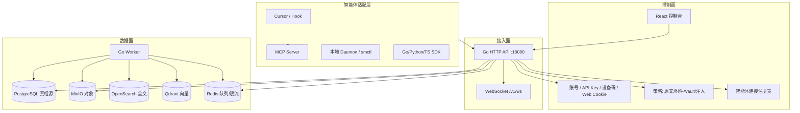
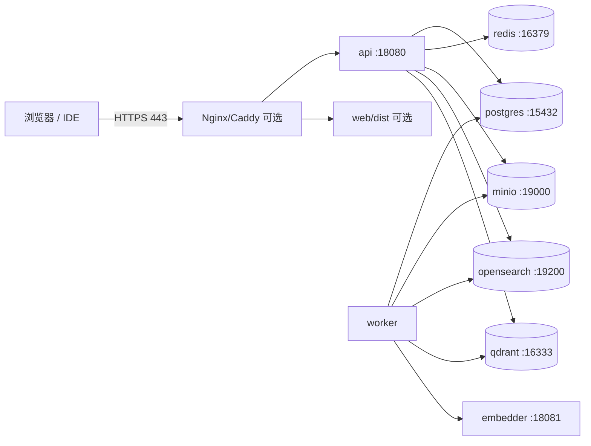
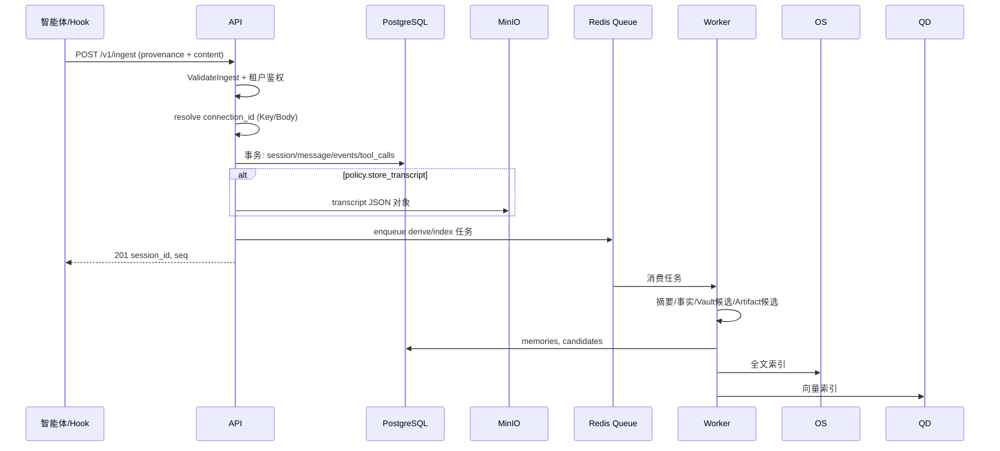
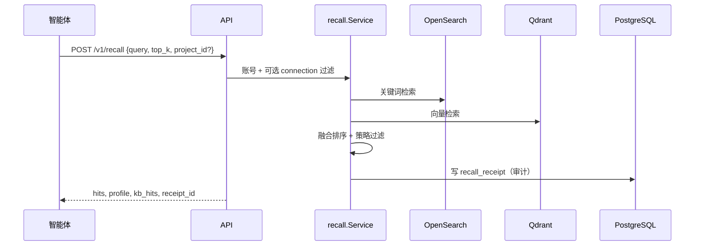
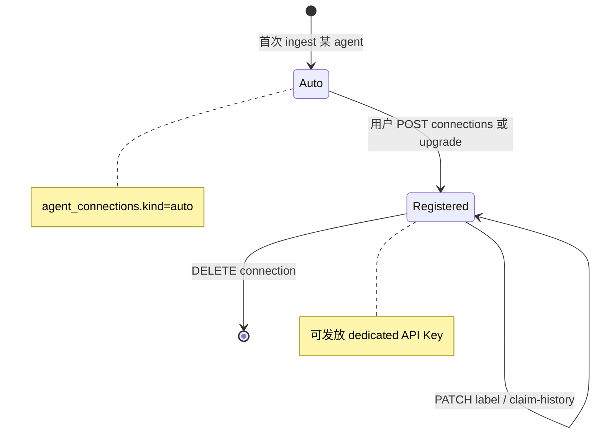

# Shared Memory 系统设计文档

> **读者：** 第一次接触本项目的开发、运维或产品经理。

---

## 1. 产品目标

**Shared Memory（共享记忆）** 为**同一账号**下的多种 AI 智能体（Cursor、Codex、Hermes、OpenClaw 等）提供：

1. **统一历史：** 在 A 客户端产生的对话，在 B 客户端可查，并保留「谁在何时、用了哪些 Skill/插件/工具」等 provenance。
2. **自动注入：** 新会话通过 **Recall** 检索全局画像 + 项目记忆 + 知识库片段，并返回可审计的 **Receipt**。
3. **分层资产：** 凭证库（Vault）、成稿库（Artifacts）、知识库（KB），均需用户确认或显式上传，密文与权限隔离。
4. **多连接归属：** 同一 `agent` 下可注册多台机器/专用 API Key，Recall 可按 **connection** 预过滤，避免串记忆。

**非目标（当前版本）：** 多租户 SaaS 计费、云厂商托管 RDS/OSS 作为默认路径、M5 级知识图谱。

**部署形态：** **自托管**为主——Docker Compose 拉起 Postgres、Redis、MinIO、OpenSearch、Qdrant、Embedder 与 API/Worker；Web 控制台可 dev 或静态部署。

---

## 2. 逻辑架构（四大平面）

| 平面 | 职责 | 主要组件 |
|------|------|----------|
| 适配层 | 把各 IDE/Agent 对话转成统一 Ingest 契约 | `adapters/*`、`cmd/mcp`、`cmd/smhook`、SDK |
| 接入面 | REST、WS、静态 Web（可选） | `internal/httpapi` |
| 控制面 | 租户、策略、审计、连接管理 | `internal/auth`、`policy`、`agents`、`web/` |
| 数据面 | 持久化、异步派生、检索投影 | `session`、`worker`、`index`、`recall` |

---

## 3. 部署架构（Compose）

**隔离原则：** 应用只连接 Compose 映射端口，不复用宿主机上其它 Postgres/Redis 实例（见主规格 §3.2）。

---

## 4. 核心数据流

### 4.1 Ingest（证据写入）

**强制字段（契约）：** `agent`、`role`、`skills`/`plugins`/`tools`（可为空数组）、`content` 或 `attachment_ids`；子智能体用 `agent_path`（如 `xiaolongxia/researcher`）。

### 4.2 Recall（记忆注入）

**Connection 维度：** 升级至 migration `0013` 后，memories/artifacts 索引与 receipt 可带 `source_connection_id`；专用 Key 自动绑定 connection，减少跨设备串命中。

### 4.3 智能体连接生命周期

- **Auto：** 未显式注册时，按 `(account_id, agent, agent_path)` 自动占位，控制台可见。
- **Registered：** 用户命名、可选专用 Key；ingest 可带 `connection_id`。
- **claim-history：** 把历史 session 归属到该 connection，并异步 reindex 相关 memories/artifacts。

---

## 5. 记忆分层模型

| 层级 | 存储 | 内容 | 用户控制 |
|------|------|------|----------|
| L0 | PG | 账号、项目、策略 | 设置页 |
| L1 证据 | PG + MinIO | 会话、消息元数据、transcript 对象、附件 | 关闭 store_transcript |
| L2 语义 | PG + OS + Qdrant | memories（事实/摘要）、profile | 记忆页 supersede/invalidate |
| L3 凭证 | PG 密文 + Vault DEK | vault_items | 候选 accept/reject |
| L4 成稿 | PG + MinIO | artifacts 正文 | 候选 accept |
| L5 知识库 | PG + MinIO + 索引 | kb_documents/chunks | KB 页上传/删除 |

---

## 6. 模块地图（Go 仓库）

| 路径 | 说明 |
|------|------|
| `cmd/api` | HTTP 入口，启动迁移与依赖注入 |
| `cmd/worker` | 队列消费者；`-reindex` 全量投影 |
| `cmd/mcp` | MCP 工具服务 |
| `cmd/smctl` | CLI：login、install 适配器、status |
| `internal/httpapi` | 路由、中间件（Auth、CORS、限流、静态 Web） |
| `internal/session` | Ingest、查询、tool_calls |
| `internal/worker` | derive、OCR、kb_parse、索引写入 |
| `internal/recall` | 混合检索 + receipt + connection 过滤 |
| `internal/agents` | agent_connections 存储与在线聚合 |
| `internal/vault` | 加密与 wrap |
| `internal/kb` | 文档与分块 |
| `internal/index` | OpenSearch/Qdrant 抽象 |
| `internal/semantic` + Embedder 解析 | TEI / OpenAI Embedder；按账号解析（部署默认 → 用户覆盖） |
| `migrations/` | SQL 版本迁移 |
| `web/` | React 控制台 |

---

## 7. 安全与多租户

1. **租户键：** 所有查询带 `account_id`（来自 API Key、Web Session 或 Device Key）。
2. **密钥：** API Key 只存 hash；Vault 用 `VAULT_MASTER_KEY` + 可选用户 wrap 密码；用户 Embedder API Key 仅存密文，GET 不回明文。
3. **Recall/Vault：** 响应禁止包含 vault 明文；receipt 可配置保留天数；账号 `reindex_required` 时跳过向量支路。
4. **限流：** Redis 滑动窗口（ingest、recall、注册连接、vault/artifact 创建、附件上传等）；Redis 不可用时可 fail-open（见配置）。
5. **CORS + Cookie：** 分域控制台时 `CORS_ORIGINS` 必须列出精确 origin，且允许 Credentials。

---

## 8. 外部集成点

| 集成 | 协议 | 用途 |
|------|------|------|
| PostgreSQL | SQL | 真相源 |
| MinIO | S3 API | 大对象 |
| OpenSearch | HTTP | BM25/中文分词 |
| Qdrant | HTTP | 向量 |
| Redis | Streams | 任务队列 + 限流 |
| Embedder | TEI `/embed` 或 OpenAI `/v1/embeddings` | **部署默认**（`.env` `EMBEDDER_*`）或 **账号覆盖**；未配置则 `HashEmbedder` |
| LLM_DERIVER_*（可选） | OpenAI API | 语义 derive |
| VISION_*（可选） | 多模态 API | 图片理解 |

---

## 9. Web 控制台信息架构

**呈现：** 珍珠玻璃 v01（`web/`，样式与动效见 [UI-V01-PEARL-LOCK.md](./UI-V01-PEARL-LOCK.md)）。登录后默认 **`#overview` 总览**（Bento：连接 KPI、待确认、常用入口）；顶栏 **Ctrl+K / ⌘+K** 命令面板跳转各 Tab；业务 Tab 标题下另有 **连接状态条**（SSE，总览页不显示）。

| Tab | Hash | 能力 |
|-----|------|------|
| **总览** | `#overview` | 连接在线汇总、待确认/项目侧卡、快捷入口 |
| 历史 | `#history` | 会话列表、详情、provenance；**分栏/列表**布局分段 |
| 记忆 | `#memory` | memories 列表与管理、召回测试 |
| 智能体 | `#agents` | 连接分组、注册、SSE 在线 |
| 凭证库 | `#vault` | 候选、条目、reveal |
| 成稿库 | `#artifacts` | 候选、正文、导出 |
| 知识库 | `#kb` | 上传、状态、删除 |
| 项目 | `#projects` | CRUD；顶栏 **当前项目** 影响列表 `project_id` |
| 密钥与回执 | `#keys` | API Key、recall receipt 查询 |
| 授权设备 | `#device` | 设备码流程 |
| 设置 | `#settings` | 策略、**Embedding（部署默认 / 用户自备 + 手动重建索引）**、删号、文档链接 |

**壳层：** 左侧凹槽导航（nav-thumb）、顶栏（面包屑、命令面板、待确认 pill、项目下拉、退出）。逐项操作与配图见 [操作手册](../manual/OPERATIONS-MANUAL.md)、[FEATURE-INDEX](../manual/FEATURE-INDEX.md)。

---

## 10. 演进与版本

- **Schema：** `0001`–`0013`（账号 Embedding 落地后 +`0014_account_embedding_settings`），API 启动自动 migrate（见 [迁移指南](../migration/MIGRATION-GUIDE.md)）。
- **索引：** 换 embedder（部署或账号）或新增 `source_connection_id` 后需重建向量投影；账号级为设置页「重建索引」，运维全局仍可用 `go run ./cmd/worker -reindex`。
---

## 11. 相关文档

- [部署指南](../deploy/DEPLOYMENT-GUIDE.md)
- [操作手册](../manual/OPERATIONS-MANUAL.md) · [图文手册](../manual/图文手册.html) · [全功能索引](../manual/FEATURE-INDEX.md)
- [UI 选型对照（v01 / p07）](./UI-SCREENSHOT-GUIDE.md)
- [验收清单](../ops/ACCEPTANCE.md)
- [API 索引](../API.md)
