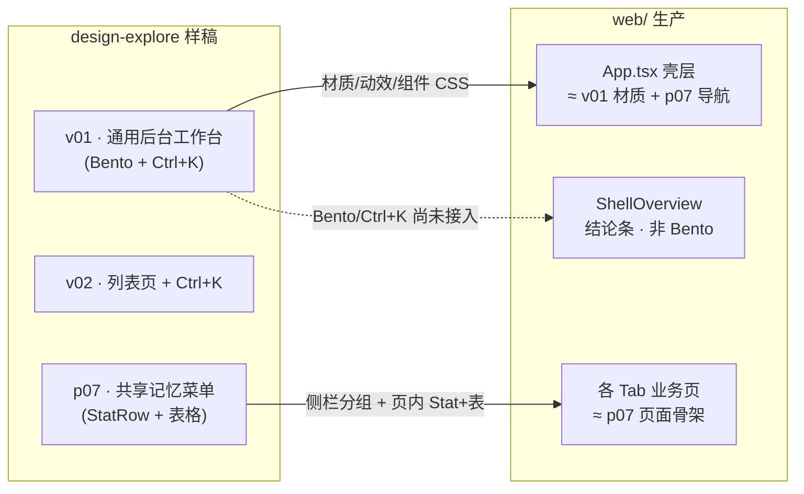
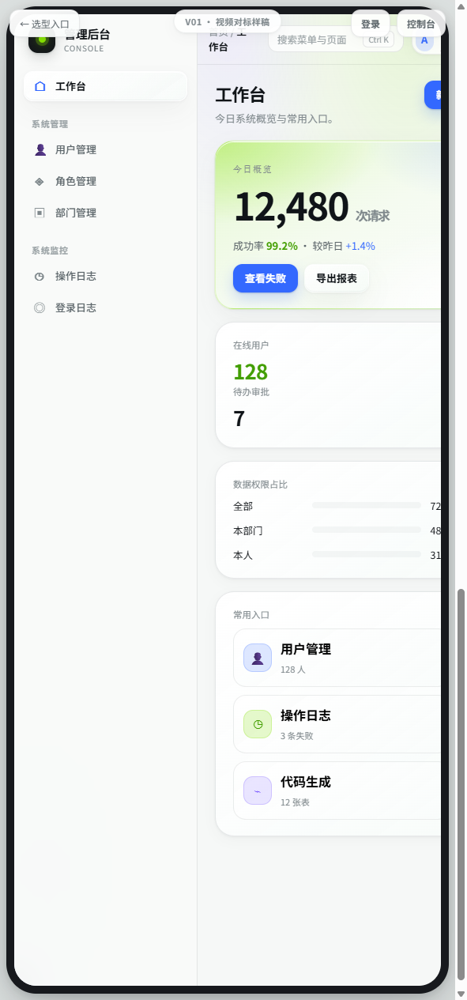
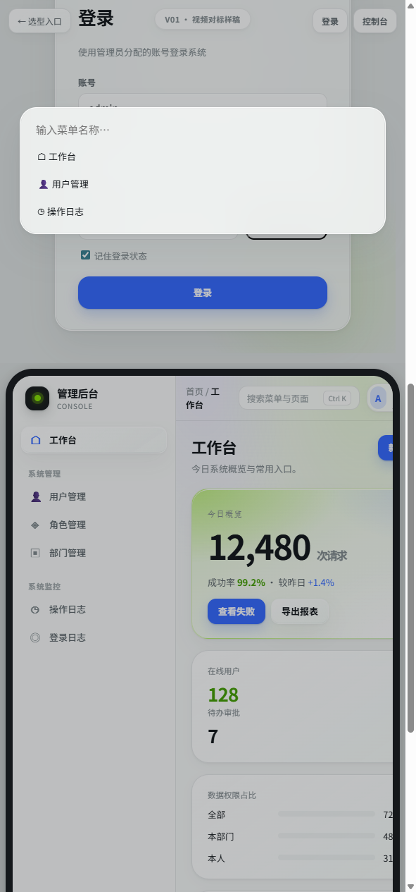
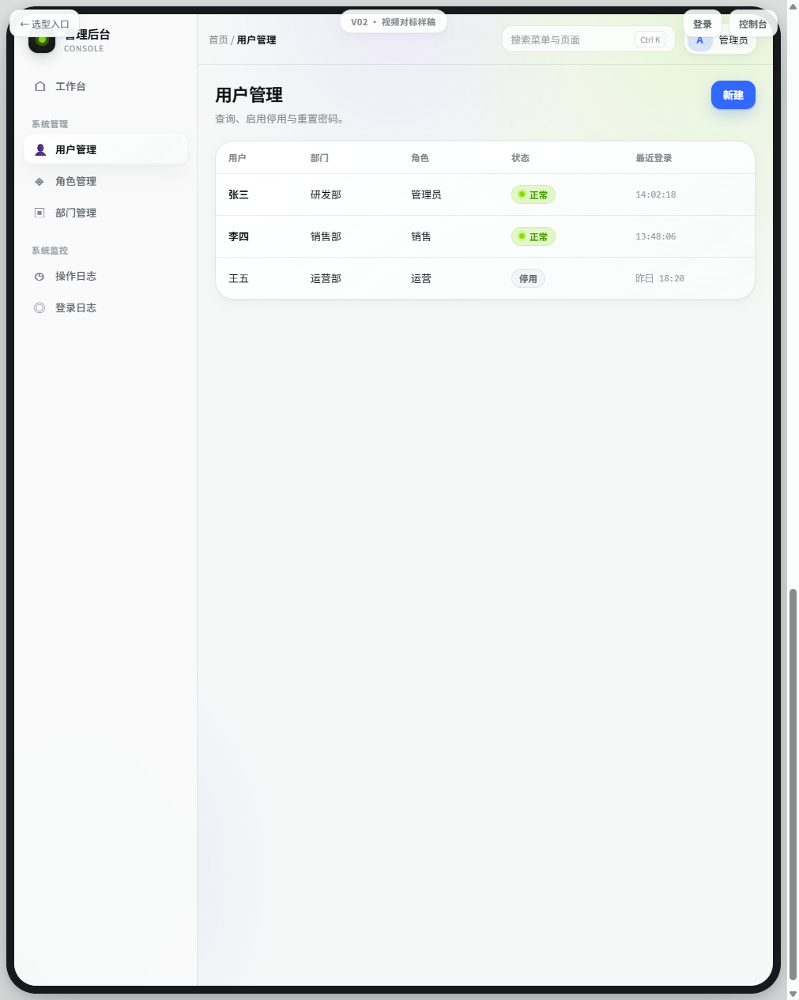
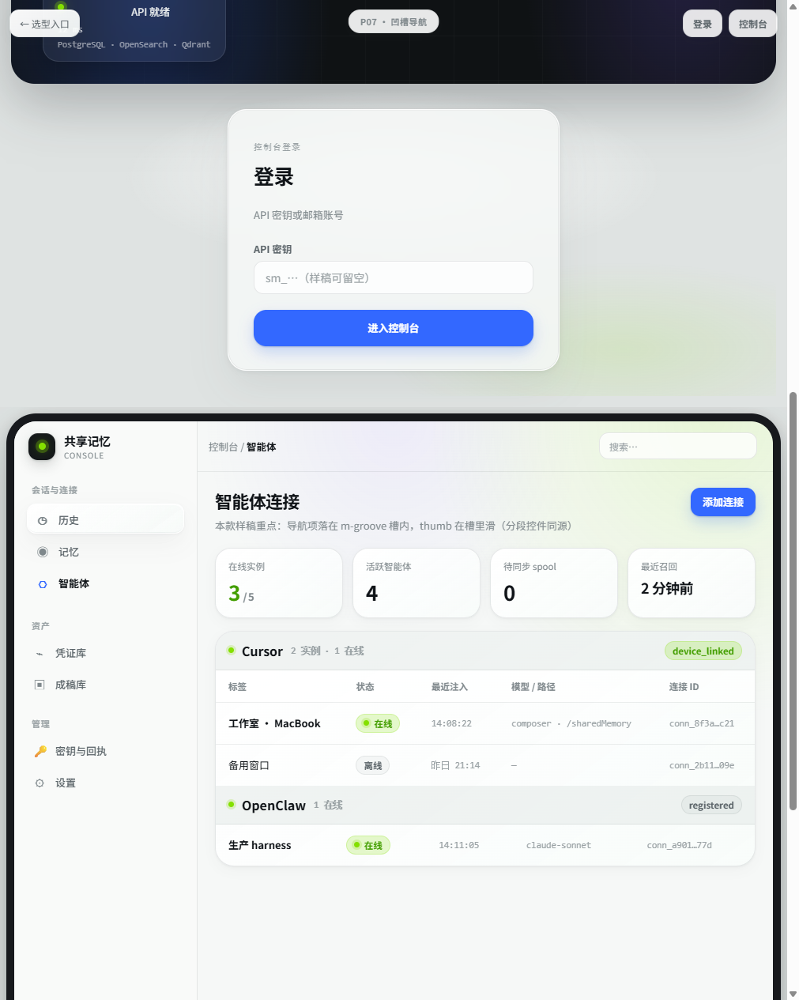

# 珍珠玻璃 UI：截图都在说明什么？

本文解释 `docs/公开/design/screenshots/` 里几张 **选型 / 对照** 截图的含义，以及它们和 **当前生产控制台**（`web/`）的关系。读完后应能回答：

- **Ctrl+K** 是什么、截图里哪一块是它？
- **Bento 总览** 和 **业务页四格 Stat** 有什么区别？
- 生产界面 **更像 v01 还是 p07**？差在哪？

---

## 1. 先分清两套「页面来源」

| 来源 | 路径 | 是什么 | 数据 |
|------|------|--------|------|
| **设计样稿** | `web/design-explore/*.html` | 静态 HTML，用于定材质、动效、布局范式 | 假文案、假数字 |
| **生产控制台** | `web/src/`（Vite + React） | 真实 Shared Memory 功能 | 真实 API |

**正式锁定的视觉语言**来自样稿 **`v01.html`**（珍珠玻璃 + 教程片动效），见 [UI-V01-PEARL-LOCK.md](./UI-V01-PEARL-LOCK.md)。

但 **菜单与业务结构** 不是 scaffold 的「用户/角色/部门」，而是 Shared Memory 的「历史/记忆/智能体/凭证库…」。这一点在样稿里用 **`p07.html`** 单独演示。



---

## 2. 一张图：生产控制台现在长什么样

生产截图在操作手册目录（Playwright 真实页面），与选型截图 **不要混为同一套菜单**：

| 手册截图 | 说明 |
|----------|------|
| [../manual/images/01-console-shell.png](../manual/images/01-console-shell.png) | 登录后 **壳层**：左侧 Shared Memory 导航 + 顶栏 |
| [../manual/images/04-agents.png](../manual/images/04-agents.png) | **智能体** Tab：四格指标 + 分组连接表（与 p07 控制台下半段同型） |

**结论（一句话）**：生产 **壳层和材质** 已向 v01 靠拢；**每个 Tab 的内容区** 更像 **p07 的业务页**（标题 + StatRow + Section/表格），**不像** v01 的「工作台 Bento 网格」。

---

## 3. `v01-console-bento.png` — Bento 总览是什么？



**对应样稿**：`web/design-explore/v01.html` 里登录后默认打开的 **「工作台」** 页（样稿里是 scaffold 文案「管理后台 / 用户管理 / 操作日志」）。

### 3.1 界面分区（自上而下）

```
┌─ 顶栏 ─────────────────────────────────────────────────────────┐
│ 面包屑「首页 / 工作台」     [ 搜索菜单与页面  Ctrl K ]  [头像] │
├─ 页头 ─────────────────────────────────────────────────────────┤
│ 工作台 · 副标题                         [ 新建 ]（主按钮）      │
├─ Bento 网格（不等分卡片，像便当盒）────────────────────────────┤
│ ┌──────────────── hero 大卡片 ──────────────┐ ┌─ side ─┐     │
│ │ 今日概览 · 超大数字 KPI · 成功率 · 双按钮   │ │ 128   │     │
│ └─────────────────────────────────────────────┘ │ 待办7 │     │
│ ┌─ third ─────────────┐                        └───────┘     │
│ │ 数据权限占比 + 占比条 │                                       │
│ └─────────────────────┘                                       │
│ ┌────────────── full 宽卡片：常用入口 quick-link 网格 ─────────┐│
│ │ 👤 用户管理   ◷ 操作日志   ⌁ 代码生成 …                      ││
│ └──────────────────────────────────────────────────────────────┘│
└────────────────────────────────────────────────────────────────┘
```

### 3.2 和「四格 Stat」的区别

| 维度 | Bento 总览（v01） | 业务页 StatRow（p07 / 生产智能体页） |
|------|-------------------|--------------------------------------|
| 出现位置 | 单独 **首页/工作台** Tab | **每个功能 Tab** 顶部 |
| 布局 | **大小卡片混排** + 快捷入口区 | **等宽四格** `stat-row` |
| 目的 | 一眼看全局 KPI + **跳转到常用模块** | 本页上下文指标（如在线实例数） |
| 生产现状 | **未实现**（无独立工作台 Tab） | **已实现**（Memory、Agents、Vault…） |

### 3.3 生产里代替 Bento 的是什么？

所有 Tab 上方固定有一块 **`ShellOverview`**（`web/src/ShellOverview.tsx`）：

- 不是网格，是一条 **结论条**（例如「3/5 连接在线 · 查看智能体 · 实时」）。
- 作用类似 Bento 的「今日概览」里的 **一句总状态**，但 **没有** 大 KPI 数字块和 **常用入口** 按钮墙。

若产品上要「v01 工作台体验」，需要新增 **总览 Tab 或首页**，用真实 API 填 `bento-grid`（样式已在 `pearl-pages.css` 迁入生产）。

---

## 4. `v01-cmd-palette.png` — Ctrl+K 命令面板是什么？



**同一张长图的上半段** 通常是 **登录页**；**下半段** 是 Bento 工作台。命令面板是 **打开后盖在全屏上的浮层**，本文件常截在「登录 + 面板打开」或「工作台 + 面板打开」状态。

### 4.1 由三部分组成

| 部分 | DOM / 类名（样稿） | 作用 |
|------|-------------------|------|
| **顶栏触发器** | `button.cmd-trigger` | 文案「搜索菜单与页面」+ 右侧 **`Ctrl K`** 键帽 |
| **遮罩** | `.cmd-overlay` | 半透明全屏，点击空白关闭 |
| **面板** | `.cmd-panel` | 搜索框 + 可点的 **cmd-item** 列表（跳转菜单） |

### 4.2 交互（样稿 `pearl-runtime.js` → `bindCmdPalette`）

1. 点击顶栏按钮 **或** 按 **`Ctrl+K` / `⌘+K`** → 打开 overlay，面板 scale 入场（GSAP）。
2. **`Esc`** 或点击遮罩 → 关闭。
3. 样稿里列表项是静态 HTML；生产接入时应 **映射到 `App.tsx` 的 Tab**（历史、记忆、智能体…）并支持 **按名称过滤**。

### 4.3 生产对比

| 项目 | v01 样稿 | 当前生产 `App.tsx` |
|------|----------|---------------------|
| 顶栏右侧 | `cmd-trigger` + 用户 chip | **项目下拉** + **退出** |
| 全局 Ctrl+K | 有 | **无** |
| CSS | `pearl-pages.css` 已拷贝到 `web/src/styles/` | 样式在，**组件未接** |

顶栏只有「搜索…」占位、**没有** Ctrl+K 的，是 **`p07.html`**（见下一节），不是 v01。

---

## 5. `v02-segmented-and-cmd.png` — 和 v01 差在哪？



**对应样稿**：`v02.html` — 同样是通用后台，但默认页是 **「用户管理」表格**，**没有 Bento 网格**。

这张图重点说明两件事可以同时存在：

1. **顶栏 Ctrl+K**（与 v01 相同）。
2. **内容区是标准列表页**：页头 + 主按钮「新建」+ `panel-table` / `data-table`。

部分 v 系列样稿在顶栏还会加 **分段控件**（见下节）；**v02 截图本身** 以 **表格页 + Ctrl+K** 为主。文件名里的 `segmented` 来自选型批次命名（与 `v05/v08` 等「顶栏表格/泳道/热力」样稿同一类微交互），**不等于** 这张图里一定画了三段切换。

**生产对照**：各业务 Tab（如设置里的表格、智能体连接表）≈ **v02 内容区**；顶栏仍缺 Ctrl+K。

---

## 6. `p07-shared-memory-console.png` — 「更像当前生产」指什么？



**对应样稿**：`web/design-explore/p07.html` — 菜单文案、分组与 **生产一致**（会话与连接 / 资产 / 管理）。

长图常见 **上下两段**：

| 段 | 内容 |
|----|------|
| **上** | Shared Memory **登录页**（API 密钥），badge「P07 · 凹槽导航」 |
| **下** | 控制台 · **智能体** 页：四格 Stat + Cursor/OpenClaw **分组表格** |

### 6.1 和生产逐项对照

| 区域 | p07 样稿 | 生产 |
|------|----------|------|
| 侧栏 | 凹槽 `m-groove` + **nav-thumb** 在槽内滑 | 已用 `nav-mode-groove` + GSAP thumb |
| 顶栏 | 仅 **「搜索…」** 占位，无 Ctrl+K | **项目选择** + 待确认 pill + 退出 |
| 页头 | 智能体连接 + 添加连接 | 各 Tab 真实标题 + 页内操作按钮 |
| 指标 | 四格 Stat | 各页 `StatRow` / `StatTile` |
| 主体 | 假数据连接表 | `AgentsPage` + 真实 API / SSE |

另存 [p07-agents-like-prod.png](./screenshots/p07-agents-like-prod.png) 多为 **仅控制台段** 的裁切，便于和手册 `04-agents.png` 并排对比。

### 6.2 「凹槽导航」和「分段滑块」的关系

样稿说明里写：**侧栏选中高亮块（nav-thumb）** 与 **分段控件里的 seg-thumb** 使用 **同一套滑动对齐逻辑**（`pearl-runtime.js` 的 `slideThumb` / 生产的 `syncSegmentThumb`）。

- **侧栏**：在 `m-groove` 导航槽里滑 — p07 强调这一点。
- **分段控件**：出现在 **页内或顶栏**（如登录模式切换、历史「分栏/列表」）— 生产已用 `Segmented` 组件接入部分页面。

---

## 7. 功能对照总表（避免「到底缺啥」）

| 能力 | v01 Bento 图 | v01/v02 Ctrl+K 图 | p07 图 | 生产 `web/` |
|------|:------------:|:-----------------:|:------:|:-----------:|
| 珍珠玻璃壳层 / 登录动效 | ✅ | ✅ | ✅ | ✅ |
| 侧栏 nav-thumb（凹槽） | ✅（thumb 模式） | ✅ | ✅（groove 强调） | ✅ |
| 顶栏 Ctrl+K 命令面板 | ✅ | ✅ | ❌ | ✅ |
| Bento 工作台首页 | ✅ | ❌ | ❌ | ✅（**总览** Tab） |
| 业务页 StatRow + 表格 | 在其它 p/v 页 | ✅ v02 | ✅ | ✅ |
| 页内 Segmented 滑块 | 部分 v 样稿顶栏 | 部分 | 文案说明 | ✅ 部分页 |
| 按压 / lift / 滚动顶栏 | runtime | runtime | runtime | ✅ interactions |

---

## 8. 本地自己打开样稿对照

```powershell
cd web/design-explore
python -m http.server 8765
```

浏览器：

| URL | 看什么 |
|-----|--------|
| http://127.0.0.1:8765/v01.html#console | Bento + 顶栏 Ctrl+K（点按钮或 Ctrl+K） |
| http://127.0.0.1:8765/v02.html#console | 表格页 + Ctrl+K |
| http://127.0.0.1:8765/p07.html#console | Shared Memory 菜单 + 智能体四格+表 |

生产：

```powershell
cd web
npm run dev
```

登录后默认 **总览**（Bento）；**Ctrl+K** 与顶栏「搜索页面」已接入。切到 **智能体** 可与 p07 下半段 / 手册 `04-agents.png` 对照。

---

## 9. 与 v01 的剩余差异（可选）

1. **顶栏用户 chip**：样稿有头像+昵称；生产仍为 **项目下拉 + 退出**（功能足够）。
2. **业务页**：保持 p07 型 StatRow + Section + DataTable，不强行整页 Bento。
3. **手册配图**：改版后运行 `scripts/capture-manual-screenshots.ps1` 与 [操作手册](../manual/OPERATIONS-MANUAL.md) 同步。

相关短索引：[screenshots/README-ui-compare.md](./screenshots/README-ui-compare.md)。
