# Shared Memory 操作手册（图文版）

> 面向**第一次打开控制台**的使用者与日常运维。部署环境请先完成 [部署指南](../deploy/DEPLOYMENT-GUIDE.md)。

### 看不到配图？（Cursor / VS Code 预览常见）

内置 Markdown 预览**经常无法加载**同目录下的 `images/*.png` / `*.svg`（会显示裂图）。请任选一种方式查看**完整配图**：

| 方式 | 操作 |
|------|------|
| **推荐** | 用 **Chrome / Edge** 打开同目录 **[图文手册.html](图文手册.html)**（双击或在资源管理器中打开） |
| 开发服务器 | `cd web && npm run dev` 后访问 `http://127.0.0.1:15173/docs/manual/图文手册.html` |
| 不依赖图片 | 阅读下文每个 **「界面线框（文字版）」** 代码块，与配图一一对应 |

配图为 **真实控制台截图**（Playwright 生成，图上含编号与底部图例）。源文件：`docs/公开/manual/images/*.png`；重新生成见 [images/README.md](images/README.md)（`scripts/capture-manual-screenshots.ps1`）。

---

## 目录

1. [开始之前：你要看到什么](#1-开始之前你要看到什么)
2. [图 1：壳层、总览与 Ctrl+K](#2-图-1壳层总览与-ctrlk)
3. [图 2：登录与注册（三种方式）](#3-图-2登录与注册三种方式)
4. [图 3：历史 — 查会话与溯源](#4-图-3历史--查会话与溯源)
5. [图 4：智能体 — 连接、专用 Key、在线](#5-图-4智能体--连接专用-key在线)
6. [记忆页：管理 derive 出的事实](#6-记忆页管理-derive-出的事实)
7. [凭证库：候选确认与查看明文](#7-凭证库候选确认与查看明文)
8. [成稿库：长文候选与导出](#8-成稿库长文候选与导出)
9. [知识库：上传、解析、Recall 命中](#9-知识库上传解析recall-命中)
10. [项目与顶栏「当前项目」](#10-项目与顶栏当前项目)
11. [密钥与回执：API 密钥与审计](#11-密钥与回执api-密钥与审计)
12. [授权设备：smctl 设备码流程](#12-授权设备smctl-设备码流程)
13. [设置：策略、隔离区、删号](#13-设置策略隔离区删号)
14. [CLI：smctl 与 MCP（示意图）](#14-clismctl-与-mcp示意图)
15. [运维图解：备份、日志、重索引](#15-运维图解备份日志重索引)
16. [故障排查速查表](#16-故障排查速查表)
17. [相关文档](#17-相关文档)  
18. [**全功能逐项索引（130+）**](FEATURE-INDEX.md)

> **看图主路径：** 注册 → **总览 / Ctrl+K** → 各业务 Tab → 打开 [图文手册.html](图文手册.html)（浏览器）。  
> **配图与 UI 不一致时**（例如仍显示旧版深色侧栏），在项目根执行 `powershell -File scripts/capture-manual-screenshots.ps1`（需 API `healthz` ok + 自动构建/截图，见 [images/README.md](images/README.md)）。PNG 写入 `docs/公开/manual/images/` 并同步到 `web/public/docs/manual/images/`。

---

## 1. 开始之前：你要看到什么

在打开浏览器前，请确认后端已就绪（否则登录页底部显示的 API 地址会连不上）。

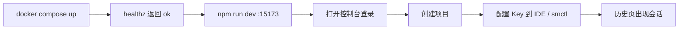

| 步骤 | 操作 | 期望结果 |
|------|------|----------|
| ① | 浏览器访问 `http://127.0.0.1:18080/healthz` | 页面显示 `ok` |
| ② | 终端 `cd web && npm run dev` | 提示 Local: `http://127.0.0.1:15173` |
| ③ | 打开 15173 | 出现 **共享记忆控制台** 登录页（见图 2） |
| ④ | API 的 `CORS_ORIGINS` 含 `http://127.0.0.1:15173` | 邮箱登录不报跨域错误 |

**截图建议：** 浏览器地址栏 + healthz 的 `ok` 文本各一张，便于新人对照「服务是否起对端口」。

---

## 2. 图 1：壳层、总览与 Ctrl+K

登录成功后进入 **珍珠玻璃控制台**：左侧凹槽导航、顶栏工具、中间为当前 Tab 内容。  
**默认首页** 为侧栏 **「总览」**（URL `#overview`），用 Bento 卡片汇总连接与快捷入口；业务 Tab 顶部另有 **连接状态条**（总览页不显示该条）。

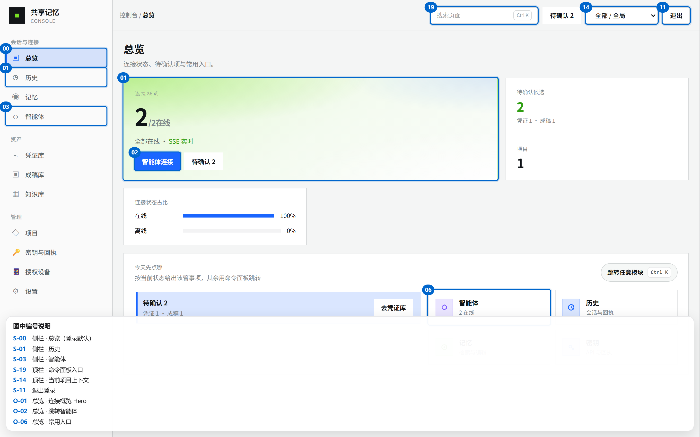

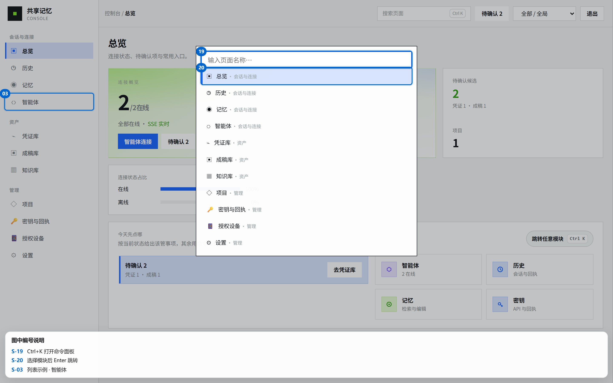

业务 Tab 标题下方的 **连接状态条**（总览页没有）：

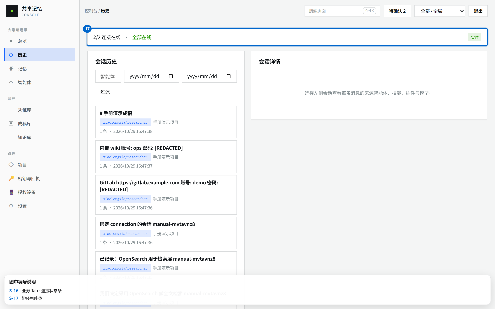

**界面线框（文字版）— 图 1 壳层 + 总览**

```text
┌─ 侧栏（珍珠玻璃 rail）─┬─ 顶栏 ─────────────────────────────────────────────┐
│ ◎ 共享记忆 Console      │ 面包屑 控制台 / 总览                                │
│ ─ 会话与连接            │  [搜索页面  Ctrl K] [待确认 N] [全部/全局 ▼] [退出] │
│   总览 ◀  （默认）       ├─ 内容区 · 总览 Tab ─────────────────────────────────┤
│   历史 / 记忆 / 智能体   │  ┌─ 连接概览（大卡片）─┐ ┌待确认┐ ┌在线/离线占比条┐ │
│ ─ 资产                  │  │  x/y 在线 · 实时 SSE │ │项目数│ └───────────────┘ │
│   凭证库 / 成稿 / 知识库 │  └ [智能体连接] [待确认]┘                         │
│ ─ 管理                  │  ┌─ 常用入口 quick-link 网格 ─────────────────────┐ │
│   项目 / 密钥 / 设备 / 设置│  历史 · 记忆 · 智能体 · 凭证库 · 密钥 · 设置 …   │ │
│ [退出登录]              │  └────────────────────────────────────────────────┘ │
└─────────────────────────┴──────────────────────────────────────────────────────┘

业务 Tab（如 历史 / 智能体）在标题下多一条「连接状态条」：
  「3/5 连接在线 · 查看智能体 · 实时」  ← SSE，点击可跳智能体页
```

**功能索引：** 壳层与总览见 [FEATURE-INDEX §2](FEATURE-INDEX.md#2-全局壳层图1)（S-00～S-20）、[§2A 总览](FEATURE-INDEX.md#2a-总览页图-1bento)（O-01～O-06）。

### 2.1 区域说明（对照配图编号）

| 区域 | 位置 | 作用 |
|------|------|------|
| **A 侧栏** | 左侧 rail | 凹槽 **nav-thumb** 随选中项滑动；分组见 §2.2 |
| **B 面包屑** | 顶栏左 | `控制台 / {当前 Tab 名}` |
| **C 命令面板入口** | 顶栏 | **搜索页面 · Ctrl K**；或键盘 **Ctrl+K** / **⌘+K** 打开跳转面板（图 1b） |
| **D 待确认** | 顶栏（有候选时） | **待确认 N**：凭证 + 成稿候选合计；点击进凭证库或成稿库 |
| **E 当前项目** | 顶栏下拉 | **全部 / 全局** 或某一项目；列表页带 `project_id` 筛选 |
| **F 总览 Bento** | 仅 `#overview` | 连接 KPI、待确认/项目侧卡、在线占比条、常用入口 |
| **G 连接状态条** | 业务 Tab 标题下 | 智能体 **在线/总数**（SSE）；总览 Tab **无**此条 |
| **H 内容区** | 中间 | 当前页列表 / 表单 / 详情 |

### 2.2 导航分组（与侧栏文案一致）

```text
会话与连接     →  总览 | 历史 | 记忆 | 智能体
资产           →  凭证库 | 成稿库 | 知识库
管理           →  项目 | 密钥与回执 | 授权设备 | 设置
```

### 2.3 命令面板（Ctrl+K）怎么用

1. 在任意已登录页面按 **Ctrl+K**（Mac：**⌘+K**），或点顶栏 **搜索页面**。
2. 输入框中键入模块名（如「智能体」「凭证」）过滤列表。
3. **↑ / ↓** 高亮，**Enter** 跳转；**Esc** 或点击遮罩关闭。
4. 列表项与侧栏 Tab 一一对应，并显示所属分组（会话与连接 / 资产 / 管理）。

### 2.4 总览页分步（登录后第一眼）

1. 确认 **连接概览** 大卡片：有连接时显示 **在线/总数**（与智能体页 SSE 同源）。
2. 若有 **待确认候选**，侧卡或 Hero 按钮会出现 **待确认 N** → 点进处理凭证/成稿。
3. 用 **常用入口** 进入历史、记忆、智能体等；或 **Ctrl+K** 更快。
4. 尚无连接时，Hero 提示去 **智能体连接** 或先在 **密钥与回执** 配置 API Key。

### 2.5 深链与 URL Hash

| Hash | 页面 |
|------|------|
| `#overview` | 总览（默认） |
| `#history` … `#settings` | 与各侧栏项一致 |

从「智能体」跳到「历史」时，会用 `sessionStorage` 预填 **智能体路径** 或 **connection_id**（无需手抄 UUID）。

**截图建议：** 总览 Bento 全屏；命令面板打开态；业务 Tab 上可见连接状态条 + 顶栏 Ctrl K。

---

## 3. 登录与注册（三种方式 · 各一张图）

### 3.0 使用顺序

```text
注册(2c) / 邮箱(2b) / API Key(2a)  →  图1 总览(#overview)  →  项目(图9)  →  密钥(图10)  →  智能体/历史等业务 Tab
```

### 3.1 API 密钥登录（图 2a）

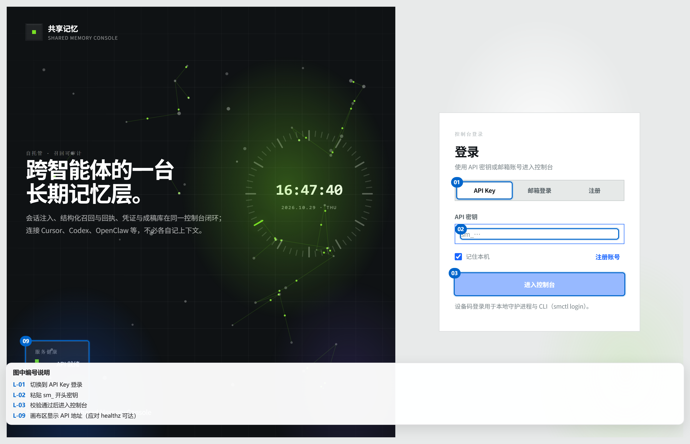

### 3.2 邮箱登录（图 2b）

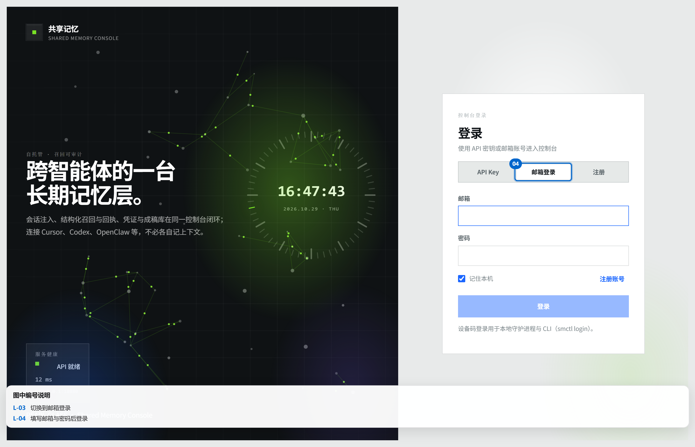

### 3.3 注册（图 2c）

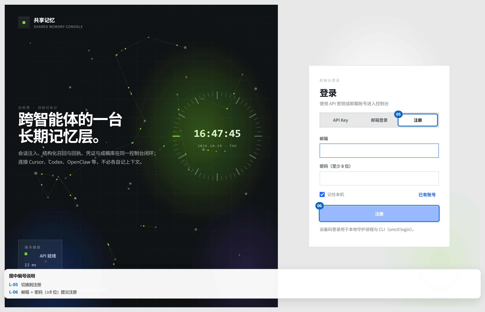

注册提交成功后会出现 **一次性 API 密钥**（图中底部图例说明各按钮）：

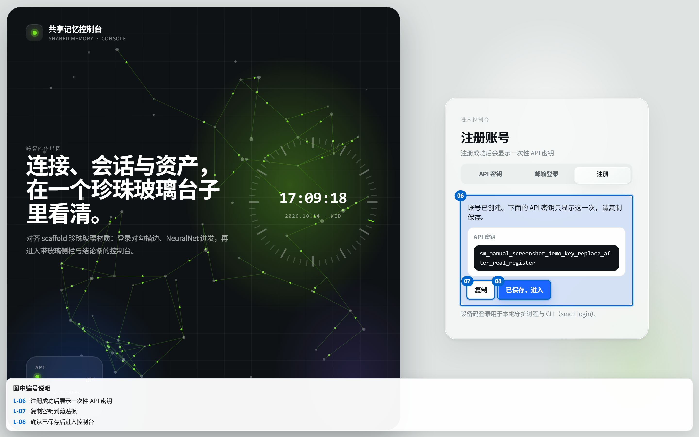

**界面线框（文字版）— 登录卡片布局**

```text
┌──────── 登录画布（NeuralNet · 时钟 · 能力 plate） ────┬──── 登录卡片（浮动玻璃） ──┐
│  共享记忆 · Shared Memory                             │  控制台登录               │
│  跨智能体长期记忆层…                                  │  [API密钥|邮箱|注册] 分段滑块 │
│  服务健康 · API 就绪                                  │  字段 + [进入控制台]      │
│  本地 API · http://127.0.0.1:18080                    │  成功 → 对勾 orb → 壳层入场 │
└───────────────────────────────────────────────────────┴───────────────────────────┘
```

> 界面中文文案以实际 Web 为准；上图为布局关系示意。

**本页全部功能编号：** 见 [FEATURE-INDEX.md §1 登录前](FEATURE-INDEX.md#1-登录前未进入壳层)（L-01～L-09）。

### 3.4 方式对比

| 模式 | 侧栏分段按钮 | 适用场景 | 登录后浏览器存什么 |
|------|--------------|----------|-------------------|
| **API 密钥** | `API 密钥` | Hook、MCP、习惯粘贴密钥的用户 | 密钥在 `localStorage`（`sm.apiKey`） |
| **邮箱登录** | `邮箱登录` | 日常用控制台、要 Cookie 会话 | 仅 Cookie（`sm.authMode=cookie`） |
| **注册** | `注册` | 新账号 | 注册成功会显示 **一次性 API 密钥**，并自动 Cookie 登录 |

### 3.5 分步：API 密钥登录

1. 若还没有密钥：先用 **注册** 拿到密钥，或登录后在 **密钥与回执** 页 **生成 API 密钥**。
2. 在登录卡选择 **API 密钥**。
3. 粘贴以 `sm_` 开头的密钥 → 点击 **进入控制台**。
4. 控制台会请求 `GET /v1/me` 校验；失败则红字 **凭证无效**。

### 3.6 分步：邮箱注册（推荐新手）

1. 选择 **注册**。
2. 填写邮箱、密码 → 提交。
3. 页面上会展示 **请妥善保存** 的 API Key（只显示一次）——建议复制到密码管理器。
4. 自动进入控制台（Cookie 已写入）。

### 3.7 分步：邮箱登录

1. 选择 **邮箱登录**。
2. 输入邮箱、密码 → **登录**。
3. 进入控制台后，Hook 仍可在「密钥」页单独创建 Key。

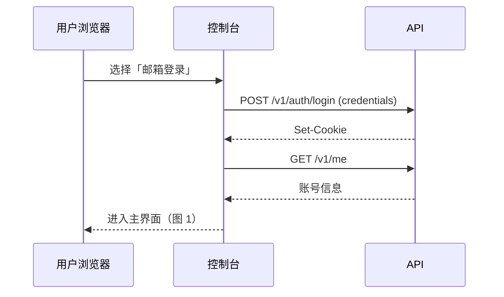

**截图建议：** 三种 segmented 按钮各一张；注册成功展示 API Key 的界面（注意打码）。

---

## 4. 图 3：历史 — 查会话与溯源

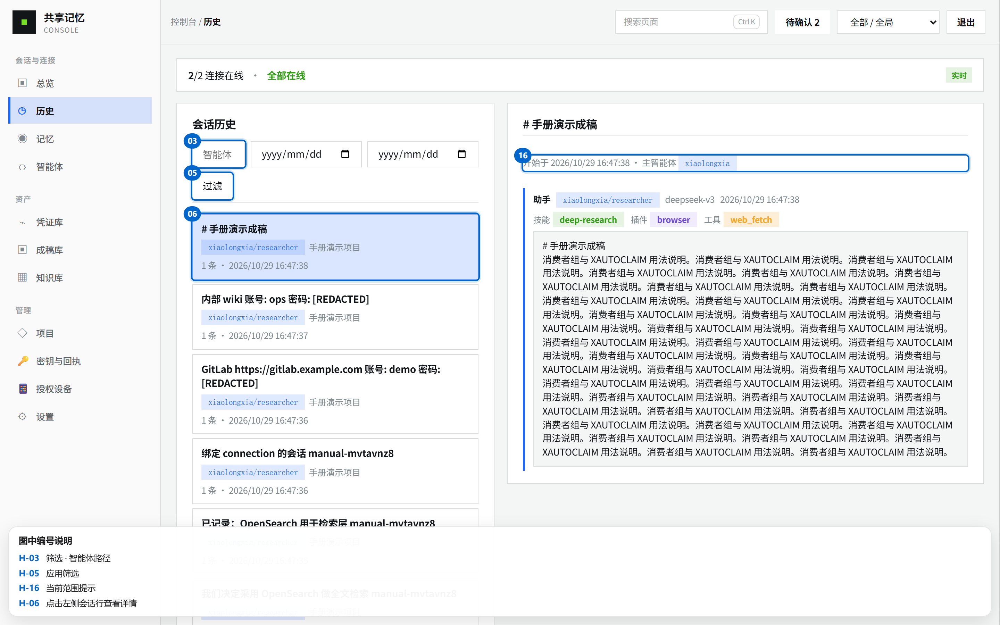

**界面线框（文字版）— 图 3**

```text
┌─ 会话历史 ──────────────┬─ 会话详情 ─────────────────────────────┐
│ [智能体路径____]         │  开始于 … · 主智能体 cursor             │
│ [connection_id____]      │  最近召回: hits=3 …                     │
│ [开始日期] [结束日期]    │  ┌ 用户 ─ cursor/researcher ────────┐  │
│ [应用筛选]               │  │ 技能 · 插件 · 工具 (Chip)          │  │
│ ─────────────────        │  │ 消息正文…                        │  │
│ ▶ 未命名会话  cursor     │  └──────────────────────────────────┘  │
│   调研 Qdrant  8条       │  ┌ 助手 ─ tool:shell ───────────────┐  │
│                          │  │ ▸ 输出（截断）  ← 点击展开        │  │
│                          │  └──────────────────────────────────┘  │
└──────────────────────────┴──────────────────────────────────────────┘
```

**功能索引：** [FEATURE-INDEX §3 历史](FEATURE-INDEX.md#3-历史图3)（H-01～H-14）。

### 4.1 页面结构

| 区块 | 说明 |
|------|------|
| **统计行** | 本页会话数、当前筛选摘要、项目上下文、**降级写入** 数量（队列不可用时的会话） |
| **布局分段** | 区块标题右侧 **分栏 / 列表** 滑块：分栏 = 左列表 + 右详情；列表 = 单列选中后在下方看详情 |
| **左侧「会话历史」** | 筛选 + 会话列表（最多 100 条） |
| **右侧「会话详情」** | 分栏模式下，点击左侧某会话后显示消息时间线 |

### 4.2 筛选器怎么用

| 字段 | 示例 | 效果 |
|------|------|------|
| 智能体路径 | `cursor`、`xiaolongxia/researcher` | 只列出 agent_path 匹配的会话 |
| connection_id | 注册连接的 UUID | 只看该连接 ingest 的会话 |
| 开始/结束日期 | 日期选择器 | 按时间范围过滤 |
| **应用筛选** | 按钮 | 提交后刷新列表（FilterPanel） |

### 4.3 会话列表每一行

- **标题**：自动生成或「未命名会话」。
- **Chip**：参与过的 `agent_path`。
- **降级**：橙色 **降级** 表示 ingest 时队列异常，语义记忆可能缺失。
- **元信息**：项目名、消息条数、最后活跃时间。

### 4.4 会话详情里每条消息

```text
┌─ 消息头 ─────────────────────────────────────┐
│ 用户/助手 · agent_path Chip · model · 时间    │
├─ 溯源 ───────────────────────────────────────┤
│ 技能 · 插件 · 工具（各为一组 Chip）            │
├─ tool_calls（若有）──────────────────────────┤
│  tool:shell  ▸ 输出（截断）  ← 点开看 pre 块   │
├─ 附件缩略图 ─────────────────────────────────┤
│  [图]  [加入知识库]                            │
└─ 正文 ───────────────────────────────────────┘
   完整 content 或「原文未保存（策略关闭）」
```

- **tool_calls 输出**：UI 用 `<details>` **输出（截断）**；完整内容用 API `GET /v1/sessions/{id}`。
- **最近召回**：详情顶部可列出与本会话相关的 **召回回执**（命中数、是否降级）。

### 4.5 典型任务 walkthrough

**任务 A：确认 Cursor 是否上报成功**

1. 顶栏项目选 **全部 / 全局**（或你的项目）。
2. 智能体路径填 `cursor` → 应用筛选。
3. 若列表为空：检查 IDE 是否配置 API Key、Worker 是否在跑（见 §16）。
4. 点击最新会话 → 右侧应看到 **技能/插件/工具** Chip。

**任务 B：从智能体页跳过来查某连接**

1. 在「智能体」某连接上点 **查看历史**（或类似跳转）。
2. 历史页自动带上 `connection_id` 筛选。

**截图建议：** 左列表 + 右详情同屏；展开一条 tool_call 的「输出（截断）」。

---

## 5. 图 4：智能体 — 连接、专用 Key、在线

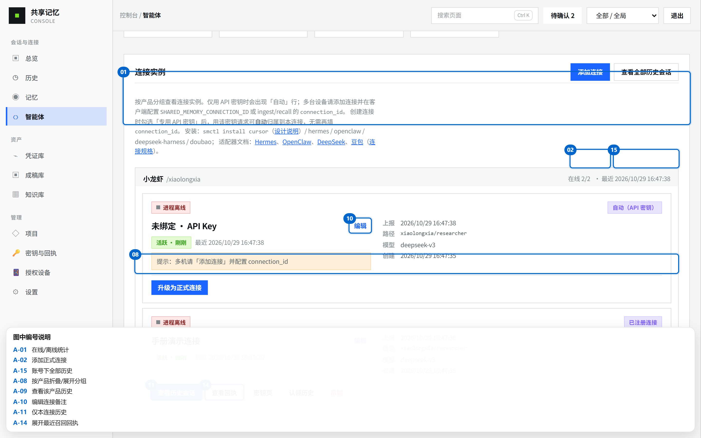

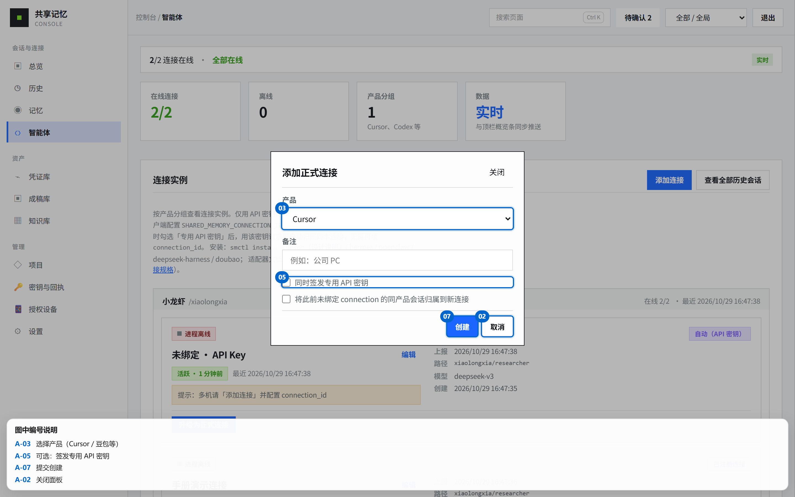

> 配图为 **真实控制台截图**；控件上的 **蓝色编号** 与 **底部图例** 对应 [FEATURE-INDEX §4](FEATURE-INDEX.md#4-智能体图4) 中的 A-xx 条目。

**界面线框（文字版）— 图 4**

```text
  在线 2 · 离线 1 ·  [ + 注册连接 ]
  ▼ Cursor
     ● 已注册连接 · 办公室 Mac · 在线     [认领历史] [修改备注] …
     ○ 自动（API Key）· 离线
  ▼ 小龙虾 (xiaolongxia)
     ● 设备 / Daemon · smctl · 在线
```

智能体页是 **多 IDE 共用同一账号** 时的「接线板」：谁在线、哪台机器、Recall 是否按连接隔离。

**功能索引：** [FEATURE-INDEX §4 智能体](FEATURE-INDEX.md#4-智能体图4)（A-01～A-19）。

### 5.1 列表怎么读

数据按 **agent 产品名** 分组（如 Cursor、小龙虾），组内有多条 **instance**：

| kind（界面文案） | 含义 | 何时出现 |
|------------------|------|----------|
| **自动（API Key）** | auto | 用账号 Key ingest 且未绑 connection |
| **已注册连接** | registered | 你在控制台 **注册连接** 或 **升级** 得到 |
| **设备 / Daemon** | device_linked | `smctl login` + heartbeat 成功后 |

**绿点 / 灰点：** **在线** 由最近 heartbeat 或 ingest 时间判定（阈值见服务端 `AGENT_HEARTBEAT_ONLINE_SEC` 等）。

页面通过 **SSE**（`/v1/agents/stream`）刷新在线状态；断流时会回退为普通 REST 拉取。

### 5.2 注册新连接（分步）

1. 点击 **注册连接** / **添加**（展开表单）。
2. **选择 agent**：下拉含 Cursor、Codex、小龙虾、爱马仕等。
3. **备注 label**：如「办公室 Mac」——便于区分实例。
4. 可选 **☑ 发放专用 API Key**：创建后只显示一次的 Key；该 Key ingest **自动** 带 `connection_id`。
5. 可选 **☑ 创建时认领历史**：把已有 auto 会话划到本连接（后台可能异步 reindex）。
6. 点击 **创建** → 若发了 Key，**立即复制**（与注册账号时的 Key 一样只显示一次）。

### 5.3 常用操作按钮

| 操作 | 作用 |
|------|------|
| **升级** | 将 **auto** 行升级为 **registered**，可填 label、可选发 Key |
| **认领历史** | 对 registered 连接：把历史 session 归属到该 connection |
| **修改备注** | PATCH label |
| **撤销连接** | 删除连接（可勾选同时吊销专用 Key） |
| **查看回执** | 按连接筛选召回回执列表 |

### 5.4 与 Recall 隔离的关系

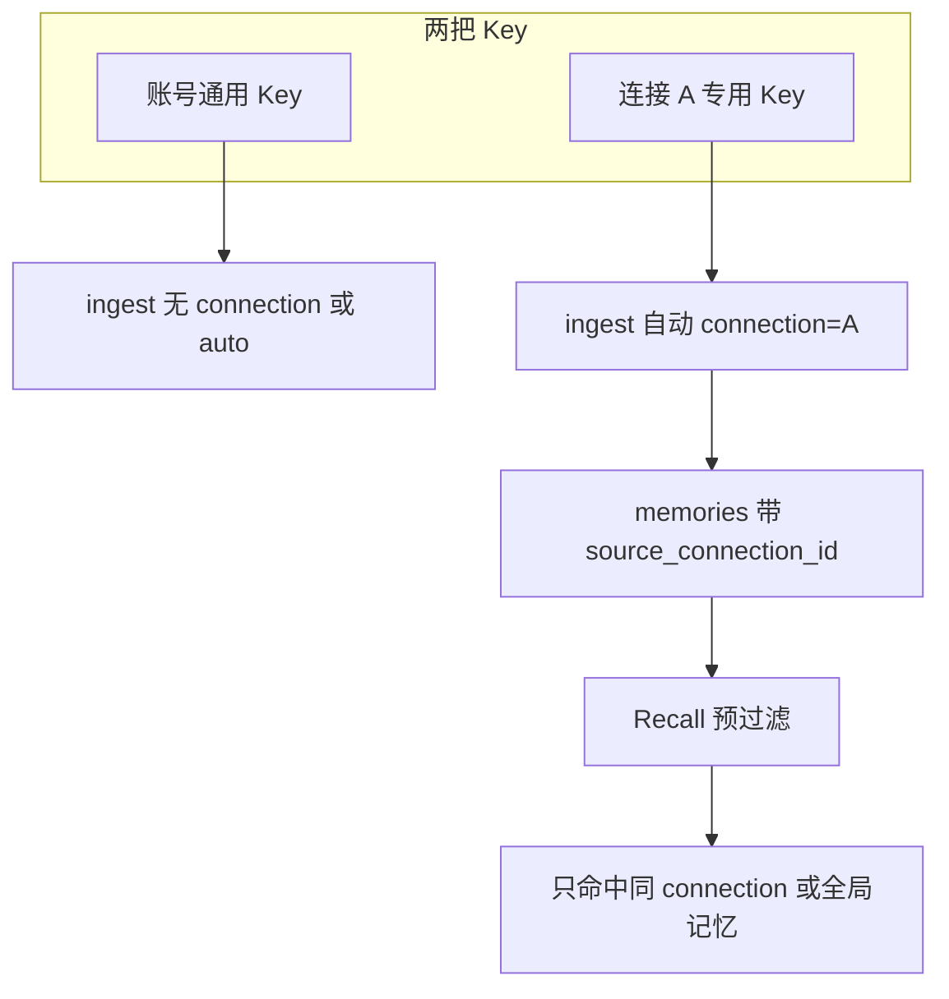

**截图建议：** 一组折叠展开，一条 **在线**、一条 **离线**；创建连接后展示 **专用 Key** 对话框（打码）。

---

## 6. 记忆页：管理 derive 出的事实

**入口：** 侧栏 **记忆**。

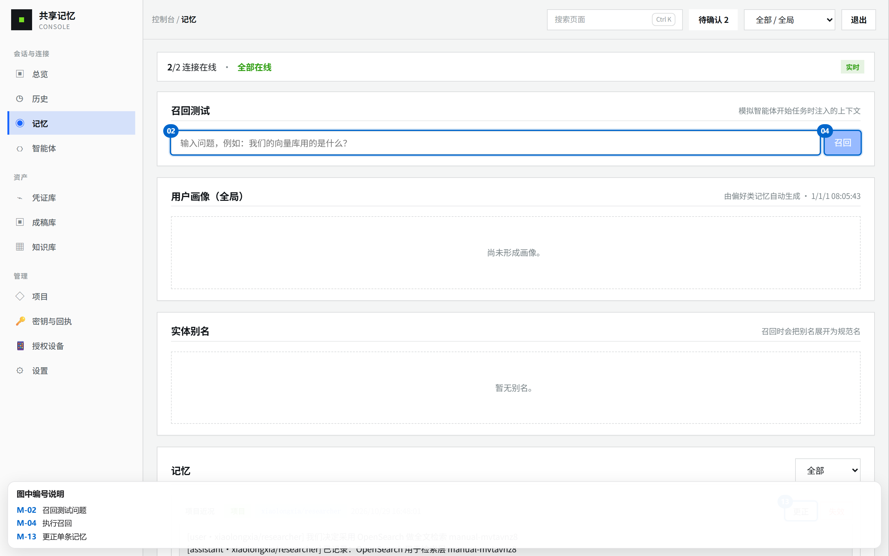

**功能索引：** [FEATURE-INDEX §5 记忆](FEATURE-INDEX.md#5-记忆图5)（M-01～M-14）。

| 元素 | 说明 |
|------|------|
| 列表 | Worker 从会话抽取的 **memories**（事实/摘要），可按项目过滤（顶栏项目） |
| **更正** | 用新事实替换旧条（supersede） |
| **失效** | 作废，召回不再命中 |

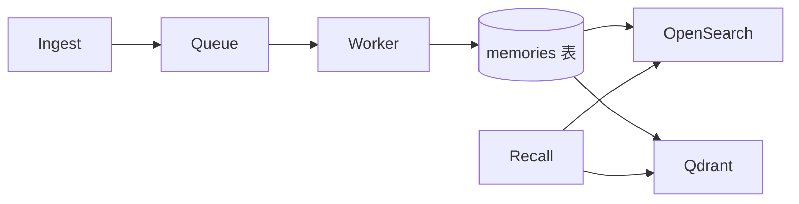

修改记忆后检索会变化；若 OpenSearch/Qdrant 与 PG 不一致，需运维 **reindex**（§15）。

**截图建议：** 一条 memory 卡片 + 操作按钮。

---

## 7. 凭证库：候选确认与查看明文

**入口：** 侧栏 **凭证库**。顶栏 **待确认** 有数字时，表示 **待确认** 区有候选。

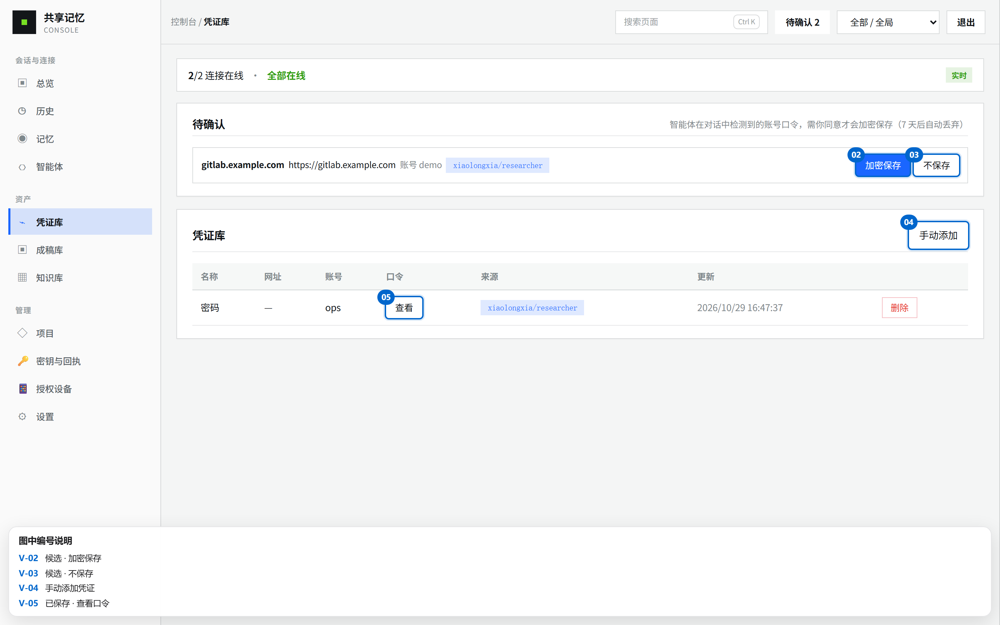

**功能索引：** [FEATURE-INDEX §6 凭证库](FEATURE-INDEX.md#6-凭证库图6)（V-01～V-08）。

**界面线框（文字版）— 凭证库**

```text
┌─ 凭证库 ───────────────────────────────────────────────────────────┐
│ 【待确认】  智能体在对话中检测到的口令（7 天未处理会丢弃）            │
│   条目 …  说明文字 …    [ 加密保存 ]  [ 拒绝 ]                      │
│ 【已保存】  名称 / 更新时间                                          │
│   条目 …    [ 查看 ] → 弹出密码框 → [ 确认查看 ] 显示明文（短暂）     │
└──────────────────────────────────────────────────────────────────────┘
```

### 7.1 两区块

| 区块 | 内容 |
|------|------|
| **待确认** | Ingest 检测到可能的口令/密钥；**7 天未处理会丢弃**（页内说明文案） |
| **已保存条目** | 加密后的 vault items |

### 7.2 分步：确认候选

1. 打开 **凭证库**（或点顶栏 **待确认**）。
2. 在 **待确认** 列表阅读上下文说明。
3. 点击 **加密保存**（accept）或拒绝。
4. accept 后条目进入下方列表，**Recall 与历史 API 不会返回明文**。

### 7.3 分步：查看明文（Reveal）

1. 在已保存条目点 **查看** / Reveal。
2. 若账号启用了 **密码 wrap**（设置页），需输入 **Vault 密码** → **确认查看**。
3. 明文仅在前端短暂展示；可复制，并应 **copied** 审计（API 支持）。

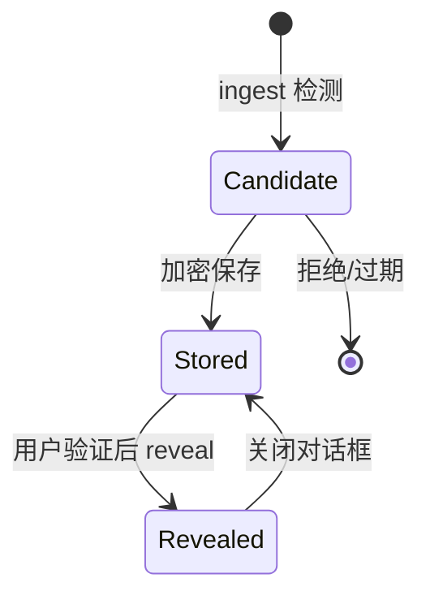

**截图建议：** 待确认一条 + 「加密保存」按钮；Reveal 密码框（假数据）。

---

## 8. 成稿库：长文候选与导出

**入口：** 侧栏 **成稿库**。

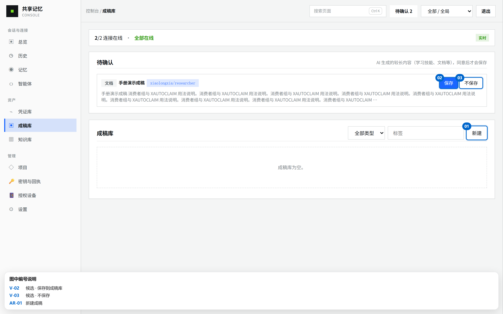

**功能索引：** [FEATURE-INDEX §7 成稿库](FEATURE-INDEX.md#7-成稿库图7)（F-01～F-10）。

**界面线框（文字版）— 成稿库**

```text
┌─ 成稿库 ───────────────────────────────────────────────────────────┐
│ 【待确认】  长 assistant 回复摘要 …    [ 接受 ]  [ 拒绝 ]             │
│ 【已保存】  标题 · 更新时间    [ 编辑 ]  [ 导出 ] 下载完整正文        │
└──────────────────────────────────────────────────────────────────────┘
```

| 阶段 | 界面 | 操作 |
|------|------|------|
| 候选 | **待确认**（与 Vault 类似，顶栏合并计数） | **接受** / 拒绝 |
| 已接受 | 成稿列表 | 编辑标题、查看正文 |
| 导出 | 条目详情 | **导出** 下载完整 body（Cookie 登录走表单 POST） |

长 assistant 回复触发候选后，接受即写入 MinIO + 索引；策略 **成稿参与检索** 在设置页开关。

**截图建议：** 候选条 + 接受后的正文预览。

---

## 9. 知识库：上传、解析、Recall 命中

**入口：** 侧栏 **知识库**。

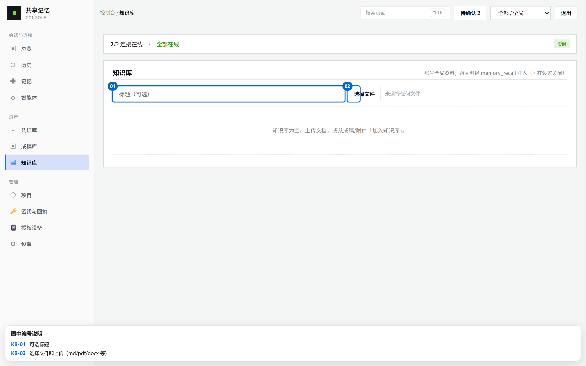

**功能索引：** [FEATURE-INDEX §8 知识库](FEATURE-INDEX.md#8-知识库图8)（K-01～K-08）。

**界面线框（文字版）— 知识库**

```text
┌─ 知识库 ───────────────────────────────────────────────────────────┐
│ [ 选择文件 ] [ 上传 ]     列表: 标题 | 来源 | 状态(pending/ready)   │
│ pending → worker 解析 → ready（可 Recall）/ error（看错误 + 重新解析）│
│ 历史页消息附件: [ 加入知识库 ] 也可入库                              │
└──────────────────────────────────────────────────────────────────────┘
```

### 9.1 文档从哪来

| 来源 | 操作位置 |
|------|----------|
| **上传** | KB 页上传文件（multipart） |
| **成稿** | 成稿详情「加入知识库」 |
| **附件** | 历史消息缩略图下 **加入知识库** |

### 9.2 状态机（界面上的 status）

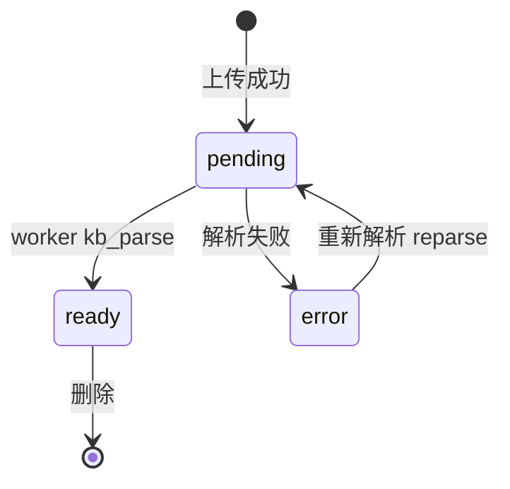

| 状态 | 用户看到 | 建议 |
|------|----------|------|
| pending | 解析中 | 等 30–45s，看 worker 日志 |
| ready | 可召回 | 在对话里 Recall 应出现 **kb_hits** |
| error | 错误信息 | 检查格式/大小；点 **重新解析** |

### 9.3 分步：上传 PDF/Markdown

1. 知识库页 → 选择文件 → 上传。
2. Toast **已上传，正在解析**。
3. 列表刷新至 **ready**。
4. 在 IDE 侧触发 **Recall**，响应中应含 `kb_hits` 数组（设置里 **召回时注入知识库** 须开启）。

**截图建议：** 一行 `ready` 文档；Recall 结果中 kb 片段（可在 Keys 页 receipt 或 IDE 侧）。

---

## 10. 项目与顶栏「当前项目」

**入口：** 侧栏 **项目**。

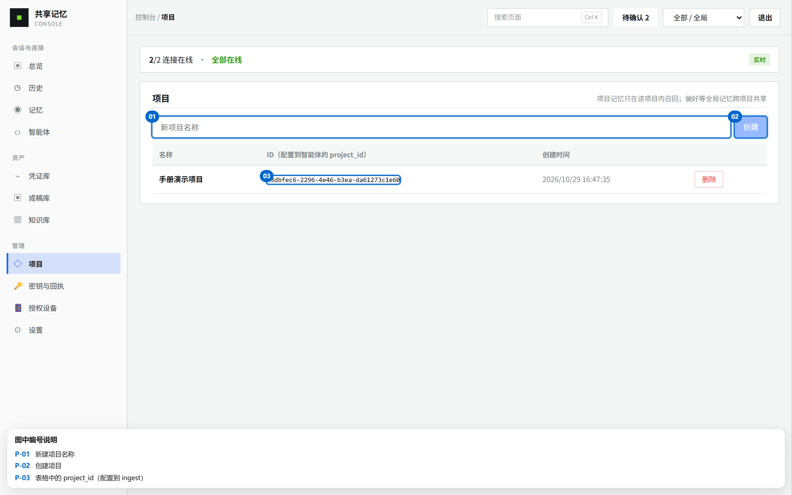

**功能索引：** [FEATURE-INDEX §9 项目](FEATURE-INDEX.md#9-项目图9)（P-01～P-03）。壳层顶栏项目下拉见 [§2 图1](FEATURE-INDEX.md#2-全局壳层图1) S-14～S-15。

| 操作 | 说明 |
|------|------|
| 创建项目 | 输入名称 → 创建 |
| 删除项目 | 确认后删除（请先确认无重要会话依赖） |
| 顶栏下拉 | 选 **全部 / 全局** = 不按 project 筛；选具体项目 = 历史/记忆等带 `project_id` |

**推荐习惯：** 每个代码仓库对应一个 Shared Memory **项目**，Hook ingest 时传 `project_id`，Recall 更准。

**截图建议：** 项目列表 + 顶栏下拉展开。

---

## 11. 密钥与回执：API 密钥与审计

**入口：** 侧栏 **密钥与回执**。

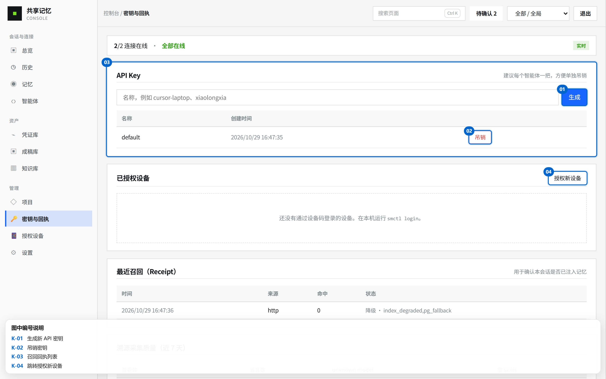

**功能索引：** [FEATURE-INDEX §10 密钥与回执](FEATURE-INDEX.md#10-密钥与回执图10)（KY-01～KY-11）。

### 11.1 API 密钥区

| 步骤 | 操作 |
|------|------|
| 创建 | 输入名称（如 `cursor-laptop`）→ 创建 → **复制** 一次性 Key |
| 撤销 | 选择 Key → 确认撤销 |
| 深链 | 可跳转 **智能体** 创建连接（`navigateTab`） |

### 11.2 召回回执区

- 列表最近 **召回回执**：时间、命中数、是否 **降级**。
- 可按 **connection_id** 筛选（从智能体页带过来时会预填）。
- 用于回答：「这次对话是否注入过记忆？命中了哪些 id？」

### 11.3 溯源统计

页内 **provenance/stats**：各 agent 消息量、unknown_model 比例等——排查 Hook 是否漏填 model/skills。

**截图建议：** 创建 Key 后展示 `sm_...`（打码）；Receipt 表格一行。

---

## 12. 授权设备：smctl 设备码流程

**入口：** 侧栏 **授权设备**。

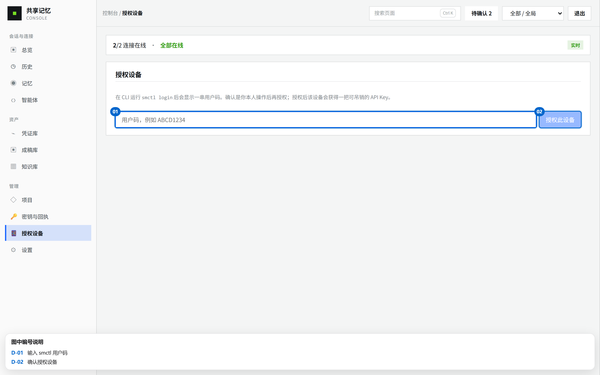

**功能索引：** [FEATURE-INDEX §11 设备](FEATURE-INDEX.md#11-授权设备图11)（D-01～D-03）。

**界面线框（文字版）— 设备授权**

```text
  终端 smctl                    浏览器「授权设备」（须邮箱 Cookie 登录）
  ┌──────────────────┐         ┌─────────────────────────────────┐
  │ smctl login      │         │ 用户码  [ ABCD1234            ] │
  │ Code: ABCD1234   │ ──────► │ [ 授权此设备 ]                  │
  └──────────────────┘         └─────────────────────────────────┘
         │ 轮询 device/token 获得 Device Key
         └─► 智能体页出现「设备 / Daemon」且在线（绿点）
```

### 12.1 流程图（CLI ↔ 浏览器）

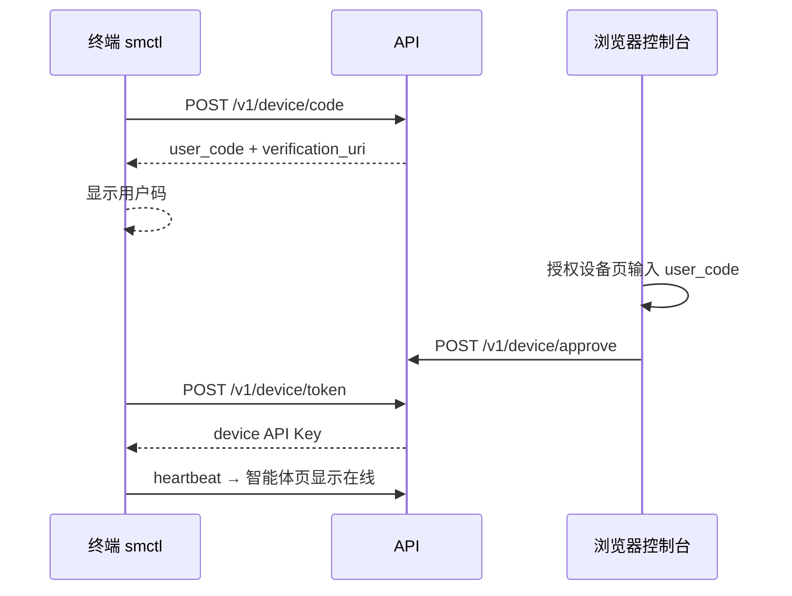

### 12.2 分步（新手）

1. 终端执行 `smctl login`（见 §14），复制 **用户码**（如 `ABCD1234`）。
2. 浏览器须 **邮箱登录**（Cookie），打开 **授权设备**。
3. 粘贴用户码 → **授权此设备**。
4. 回到终端等待完成；**智能体** 页出现 **设备 / Daemon** 行且 **在线**。

URL 带 `?user_code=` 时会 **自动填入** 输入框。

**截图建议：** 终端 user_code + 浏览器授权页同屏（打码）。

---

## 13. 设置：策略、隔离区、删号

**入口：** 侧栏 **设置**。

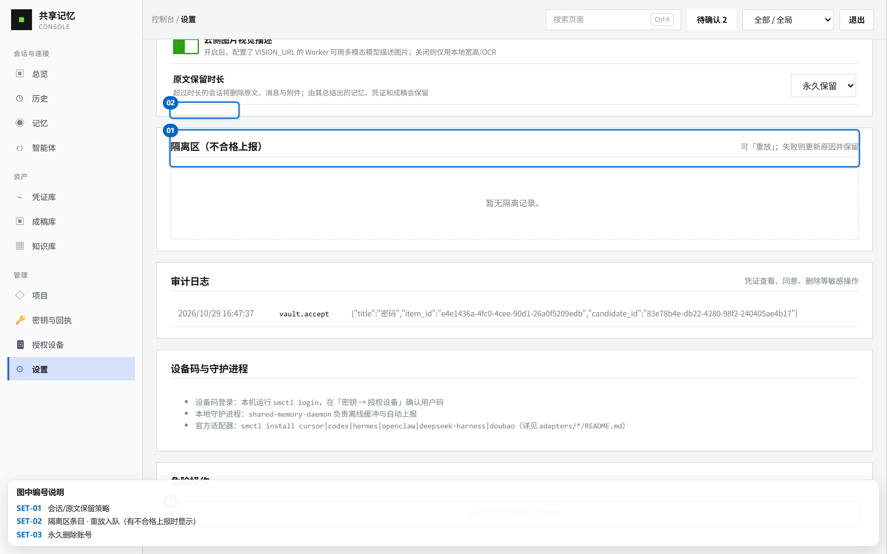

**功能索引：** [FEATURE-INDEX §12 设置](FEATURE-INDEX.md#12-设置图12)（ST-01～ST-15）。

**界面线框（文字版）— 设置**

```text
┌─ 设置 ─────────────────────────────────────────────────────────────┐
│ 策略（Toggle，切换即保存）                                            │
│  (●) 保存聊天原文   (●) 保存附件   (●) 自动注入记忆                   │
│  (●) 召回时注入知识库   (●) 检测账号口令   (●) 成稿参与检索           │
│  保留天数 [ 永久 ▼ ]    桌面通知 [ ]                                  │
│ ── Vault 包装密码 ──  ── 隔离区表格 [重放] ──  ── 删除账号 ──        │
└──────────────────────────────────────────────────────────────────────┘
```

### 13.1 策略开关（与界面文案一致）

| 开关 | 含义 |
|------|------|
| 保存聊天原文 | 关 → 历史详情显示「原文未保存」，MinIO 无 transcript |
| 保存附件文件 | 关 → 仅元数据 |
| 自动注入记忆 | 关 → Recall 仍可手动调，但产品默认注入关闭 |
| 召回时注入知识库 | 关 → Recall 无 kb_hits |
| 检测账号口令 | 关 → 不产生 vault 候选 |
| 成稿参与检索 | 关 → Recall 不搜成稿 |
| 云侧图片视觉描述 | 需 Worker 配 `VISION_URL` |
| 保留天数 | 0 = 永久；否则 retention 任务清理 |

每个 Toggle 切换后自动 **PUT /v1/policy** 并 Toast **设置已保存**。

### 13.1.1 Embedding

设置页 **Embedding** 区块调用 `GET/PUT/DELETE /v1/embedding-settings`，以及 `POST .../probe` 与 `POST .../reindex`。

- 不启用覆盖时使用部署 `.env` 的 `EMBEDDER_*`；部署 URL 也为空时用本地哈希，向量质量较差。
- 协议为 TEI（`POST /embed`）或 OpenAI 兼容（`POST /v1/embeddings`）。保存前服务端探测真实维度，超过 `EMBEDDER_MAX_DIM`（默认 4096）会拒绝。
- API Key 只存密文，页面只显示是否已设置。
- 更换模型、地址或维度后出现重建提示，向量写入和向量召回暂停，直到点击 **重建索引** 成功。

### 13.2 桌面通知

开启后，有待确认凭证/成稿且浏览器允许 Notification 时，会弹 **Shared Memory** 通知；**点击通知** 跳到 vault 或 artifacts。

### 13.3 Vault 密码 wrap

在设置区配置 **Vault 包装密码**（与 `wrap-setup` API 对应）；之后 Reveal 需额外密码。

### 13.4 隔离区（Ingest quarantine）

表格列：**时间 · 智能体 · 原因 · 操作**。

| 按钮 | 作用 |
|------|------|
| 复制 payload | 调试 Hook 上报 JSON |
| 重放 | 修复 Hook 后重试 ingest |

### 13.5 审计日志

只读列表，最近 50 条 **action**（策略变更等）。

### 13.6 删除账号

输入确认 → **删除账号** → 数据不可恢复；Cookie 会话退出。

**截图建议：** 策略 Toggle 列表；隔离区一行 + 「重放」。

---

## 14. CLI：smctl 与 MCP（示意图）

控制台负责「看与管理」；IDE 侧常用 **smctl** 与 **MCP** 写入/召回。

```text
  ┌─────────────┐         Bearer API Key          ┌─────────────┐
  │   Cursor    │ ──Hook / MCP───────────────────►│  API :18080 │
  │   Codex     │                                 │  ingest     │
  └─────────────┘                                 │  recall     │
        ▲                                         └──────▲──────┘
        │ smctl install 写配置                            │
  ┌─────┴─────┐                                    ┌─────┴─────┐
  │  smctl    │ login / status / adapters          │  Worker   │
  └───────────┘                                    └───────────┘
```

```powershell
go build -o smctl.exe ./cmd/smctl
smctl login --api http://127.0.0.1:18080
smctl install --adapter openclaw
smctl status
```

可选环境变量 **`SHARED_MEMORY_CONNECTION_ID`**：绑定到某 **已注册连接**（与专用 Key 二选一）。

MCP：构建 `cmd/mcp`，在 Cursor MCP 配置中指向二进制并配 Key；工具列表见仓库测试 `internal/mcp/server_test.go`。

适配器图文说明：`adapters/*/README.md`（Web 内 **文档链** 同步到 `web/public/adapters`）。

---

## 15. 运维图解：备份、日志、重索引

### 15.1 日常查看

```powershell
docker compose ps
docker compose logs -f api
docker compose logs -f worker
```

### 15.2 备份

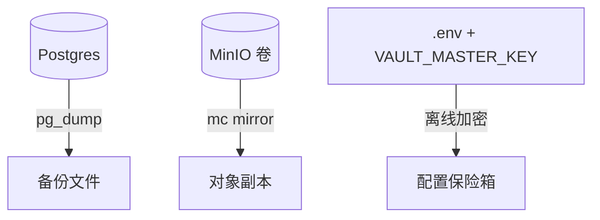

脚本示例：`scripts/ops/backup-postgres.example.sh`。

### 15.3 全量重索引

升级 **0013**、更换 embedder 或搜索不一致时：

```powershell
$env:SHARED_MEMORY_ENV = ".env"
go run ./cmd/worker -reindex
```

### 15.4 发布验收

```powershell
powershell -File scripts/e2e-smoke.ps1
```

结果解读：见 [验收清单](../ops/ACCEPTANCE.md)。

---

## 16. 故障排查速查表

| 现象 | 看图/页 | 可能原因 | 处理 |
|------|---------|----------|------|
| 登录页底部 API 连不上 | 图 2 | API 未起 | `docker compose --profile app up -d --build` |
| 邮箱登录 CORS 红字 | 图 2 | 缺 CORS | `.env` 加控制台 origin |
| 历史永远空 | 图 3 | 无 ingest / 筛错 | 查 Key、项目、agent_path |
| 原文不显示 | 图 3 详情 | 策略关 transcript | 设置 → 保存聊天原文 |
| 智能体页空 | 图 4 | API 旧镜像 | rebuild；`GET /v1/agents` 勿 404 |
| 在线不亮 | 图 4 | 无 heartbeat | smctl / daemon；看 last_ingest |
| KB 一直 pending | §9 | worker 挂 | logs worker；reparse |
| Recall 空 | §6 图 | 索引未建 | 等 worker；reindex |
| Vault reveal 失败 | §7 | wrap 密码 / MASTER_KEY | 设置 wrap；恢复备份 KEY |
| 待确认不消失 | 图 1 · D | 未点接受 | 凭证库/成稿库或总览「待确认」按钮 |

---

## 17. 相关文档

- [部署指南](../deploy/DEPLOYMENT-GUIDE.md)
- [系统设计](../design/SYSTEM-DESIGN.md)
- [迁移指南](../migration/MIGRATION-GUIDE.md)
- [验收清单](../ops/ACCEPTANCE.md)
- [文档导航](README.md)
- [配图说明](images/README.md)

---

**文档版本：** 2026-10-14 图文版  
**维护：** 界面改版时请同步更新 `images/*.svg` 或替换为截图，并核对各 Section 标题与 `web/src/pages/*` 一致。
